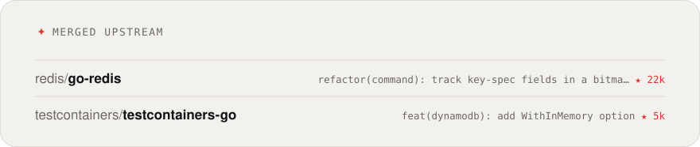

<picture>
  <source media="(prefers-color-scheme: dark)" srcset="assets/header-dark.svg">
  
</picture>

### <samp>&gt; Hi, I'm Matin Askari · متین عسکری</samp>

Software engineer from Isfahan, working on backends, systems and the occasional messaging bot: APIs, web apps and services kept clear, reliable and easy to extend. Lately I spend my spare hours fixing bugs in open-source Go and Node.js projects.

 

 

<picture>
  <source media="(prefers-color-scheme: dark)" srcset="assets/stats-dark.svg">
  
</picture>

<picture><source media="(prefers-color-scheme: dark)" srcset="assets/streak-dark.svg"></picture>
<picture><source media="(prefers-color-scheme: dark)" srcset="assets/languages-dark.svg"></picture>

<picture>
  <source media="(prefers-color-scheme: dark)" srcset="assets/oss-dark.svg">
  
</picture>

#### <samp>Latest writing</samp>

<!-- WRITING:START -->
- <samp>2026-11-06</samp> &nbsp; [Building a Telegram or Bale Bot for Your Business: From Idea to Payments](https://www.askari.pro/en/blog/build-telegram-bale-business-bot)
- <samp>2026-11-06</samp> &nbsp; [What Is MCP? A Simple Guide to the Model Context Protocol and Its Security](https://www.askari.pro/en/blog/what-is-mcp)
- <samp>2026-11-06</samp> &nbsp; [Will AI Agents Replace Software Developers? What Is Really Changing in 2026](https://www.askari.pro/en/blog/will-ai-agents-replace-developers)
- <samp>2026-11-06</samp> &nbsp; [What Is Vibe Coding, and Why Do AI-Built Apps Break in Production?](https://www.askari.pro/en/blog/vibe-coding-in-production)
<!-- WRITING:END -->

#### <samp>Stack</samp>

     
     

 

<picture>
  <source media="(prefers-color-scheme: dark)" srcset="assets/snake-dark.svg">
  
</picture>

Cards are rebuilt every day from live GitHub data by <a href="scripts/build-cards.mjs">a small script</a>.
