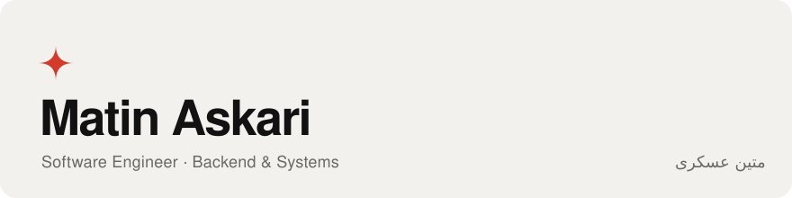
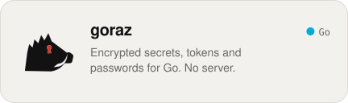
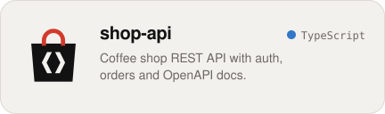
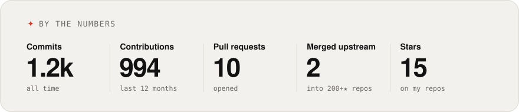
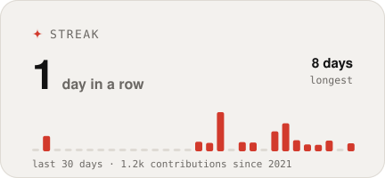
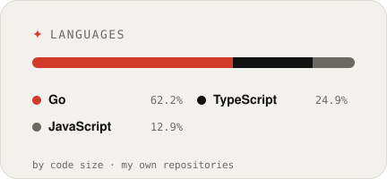

<picture>
  <source media="(prefers-color-scheme: dark)" srcset="assets/header-dark.svg">
  
</picture>

### <samp>&gt; Hi, I'm Matin Askari · متین عسکری</samp>

Software engineer from Isfahan, working on backends, systems and the occasional messaging bot: APIs, web apps and services kept clear, reliable and easy to extend. Lately I spend my spare hours fixing bugs in open-source Go and Node.js projects.

 

 

<a href="https://github.com/mtnaskari/goraz"><picture><source media="(prefers-color-scheme: dark)" srcset="assets/project-goraz-dark.svg"></picture></a>
<a href="https://github.com/mtnaskari/shop-api"><picture><source media="(prefers-color-scheme: dark)" srcset="assets/project-shop-api-dark.svg"></picture></a>

<a href="https://github.com/pulls?q=is%3Apr+is%3Amerged+author%3Amtnaskari+-user%3Amtnaskari">
<picture>
  <source media="(prefers-color-scheme: dark)" srcset="assets/stats-dark.svg">
  
</picture>
</a>

<picture><source media="(prefers-color-scheme: dark)" srcset="assets/streak-dark.svg"></picture>
<picture><source media="(prefers-color-scheme: dark)" srcset="assets/languages-dark.svg"></picture>

#### <samp>Merged upstream</samp>

<!-- OSS:START -->
- [**redis/go-redis**](https://github.com/redis/go-redis) <samp>★ 22k</samp> &nbsp; [refactor(command): track key-spec fields in a bitmask #4278](https://github.com/redis/go-redis/pull/4278)
- [**testcontainers/testcontainers-go**](https://github.com/testcontainers/testcontainers-go) <samp>★ 5k</samp> &nbsp; [feat(dynamodb): add WithInMemory option #4094](https://github.com/testcontainers/testcontainers-go/pull/4094)
<!-- OSS:END -->

#### <samp>Latest writing</samp>

<!-- WRITING:START -->
- <samp>2026-11-06</samp> &nbsp; [Building a Telegram or Bale Bot for Your Business: From Idea to Payments](https://www.askari.pro/en/blog/build-telegram-bale-business-bot)
- <samp>2026-11-01</samp> &nbsp; [Software Development Contracts: 12 Clauses That Prevent Disputes](https://www.askari.pro/en/blog/software-development-contract-clauses)
- <samp>2026-10-26</samp> &nbsp; [What Is MCP? A Simple Guide to the Model Context Protocol and Its Security](https://www.askari.pro/en/blog/what-is-mcp)
- <samp>2026-10-20</samp> &nbsp; [Software Project Contract and Delivery Checklist](https://www.askari.pro/en/blog/software-project-contract-checklist)
<!-- WRITING:END -->

#### <samp>Stack</samp>

     
     

 

<picture>
  <source media="(prefers-color-scheme: dark)" srcset="assets/snake-dark.svg">
  
</picture>

Cards are rebuilt every day from live GitHub data by <a href="scripts/build-cards.mjs">a small script</a>.
